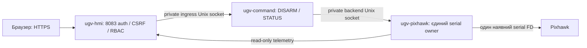

# Технічне рішення щодо трьох блокерів DISARM

> Історичний висновок щодо strict-ACK вимоги. Користувач надалі погодив
> варіант DISARMED_OBSERVED зі штатним ArduPilot. Чинна реалізація та її
> обмеження — README.md і OBSERVED_VALIDATION.md; strict firmware extension
> не реалізовано і не потрібно для спостережної семантики.

Дата: 2026-11-16. Гілка: `feature/ugv-hmi-disarm`.
HEAD: `f4462926b40dc888a77b18e6fbce105dd0a776a5`.
Статус: дослідження й запропонована архітектура, **не реалізація і не дозвіл на deployment**.
Цей документ уточнює умови в AUDIT.md та DEPLOYMENT.md; поточний engine
із 254 identities залишається незміненим і обмеженим.

## 1. Висновок і модель гарантій

Довгострокове строге зіставлення необмеженої кількості DISARM зі штатним
COMMAND_ACK **не підтверджується** лише змінами companion-коду.
За моделі довільно затриманих старих ACK адреси колись доведеться
перевикористати, а ACK не повертає ідентифікатор запиту.
Локальний epoch, новий UID або перезапуск не змінюють поля такого ACK.

Для збереження вимоги «підтверджено виконання саме цієї транзакції»
рекомендовано окремо погоджене розширення протоколу/firmware із токеном,
видимим FC та атомарно пов'язаним з дією. Якщо firmware має залишитися
штатним, допустимий інший продуктово погоджений контракт: повідомляти
спостережений стан DISARMED, не заявляючи про підтверджене виконання
конкретного запиту. Це не рівнозначні гарантії.

UID-ізоляція технічно здійсненна, але поточний пакет не сумісний з нею
без змін IPC/DAC, state paths і legacy 8084 write API. Реальна підтримка
адресованих ACK даною прошивкою/каналом зараз залишається UNKNOWN.

## 2. Факти, перевірені без змін системи

| Об'єкт | Результат read-only перевірки |
| --- | --- |
| Owner | ugv-hmi.service, PID 960, User/Group=ugvs2; hold_runner, 8082/8084 |
| Authorized HMI | ugv-hmi-auth.service, PID 1524, User/Group=ugvs2; Gunicorn, 8083 |
| Стан служб | active/running, початкові PID збережені |
| Наявна HTTP-телеметрія | CONNECTED, свіжий HEARTBEAT, MANUAL / DISARMED; не є доказом ACK capability |
| Схема API 8082 | не містить firmware fingerprint, raw frame type/signature чи COMMAND_ACK |
| Доступ до домашнього каталогу | /home/ugvs2, active auth release та state directory мають mode 0700 |
| Групи ugvs2 | містять dialout, sudo, gpio та інші; нові service UID їх успадковувати не повинні |
| Запропоновані UID | ugv-hmi, ugv-command, ugv-pixhawk не знайдені через getent; не створювалися |
| systemd | 257; рекомендовані опції потрібно перевіряти локально, а не лише за latest man page |
| Поточні sandbox properties | NoNewPrivileges=no, PrivateDevices=no, ProtectSystem=no, ProtectHome=no; DevicePolicy=auto |

Широкий CapabilityBoundingSet сам по собі не означає, що непривілейований
процес має ці effective capabilities. Поточна конфігурація, однак, не задає
потрібної новому gateway межі ізоляції.

Перевірялися лише вихідні файли, systemd metadata, каталогові права і GET
наявної телеметрії. Serial не відкривався, нових MAVLink повідомлень не було.
Identity DB не відкривалась, не скидалася й не замінювалася.

## 3. Чому ліміт 254 реальний

У disarm_control/engine.py таблиця identities зберігає component ID для
request_id; використовуються 1..255, окрім HOLD component 190, при system=255.
Після кожного нового durable intent одна адреса назавжди зайнята — навіть
якщо запит не дійшов до write. Рестарт позначає незавершені ERROR_RESTART,
але не звільняє identities. Цю гарантію не можна послаблювати очищенням DB.

Розрізняємо:

1. Повтор уже отриманого пакета.
2. Затриманий пакет, якого receiver ще не бачив.
3. ACK іншої команди 400/іншого GCS з адресою, що збігається.
4. Втрату локального контексту після рестарту, owner handoff або rollback OS image.

Якщо source identity повториться, старий справжній ACK може мати ті самі
command/source/target fields, що й новий. Присвоєний при отриманні новий
monotonic timestamp не доводить, коли та для якого запиту ACK був створений.
Це висновок із структури протоколу, а не знайдена гарантія ArduPilot.

### Порівняння варіантів

| Варіант | Що дає | Залишкова проблема / рішення |
| --- | --- | --- |
| Поточні 254 адреси без reuse | Обмежена консервативна робота за умови резервування адрес | Тимчасовий режим, не довгострокове рішення |
| Більший pool system/component IDs | Більше транзакцій | Скінченний простір, конфлікти GCS/SYSID policy; не усуває проблему |
| Циклічний reuse, DB reset, випадковий component | Знімає видимий ліміт | Старий ACK знову може збігтися; відхилити |
| Тільки один запит in-flight, локальний epoch/counter | Ідемпотентність і контроль конкуренції | Epoch не повертається FC; старий ACK не відрізняється |
| Signing + persistent replay high-water marks | Автентичність і захист від повторного прийняття відомих пакетів | Не перетворює раніше не бачений delayed ACK на ACK цього запиту |
| Signing + перевірений session fence / drain | Потенційно придатний варіант за доведених меж усіх черг і старих команд | FIFO, повнота fence, signing streams, максимальна затримка та FC semantics не доведені; зараз блокер |
| FC-visible nonce/epoch з автентифікованою відповіддю | Пряма прив'язка до запиту, практично невичерпний namespace | Потрібне firmware/dialect/service розширення й окреме погодження |
| Stock FC + DISARMED_OBSERVED | Чесне підтвердження поточного спостереженого стану | Не підтвердження причинного виконання запиту; потрібна зміна UX/acceptance contract |

Signing перевіряє timestamp потоку system/component/link. Він потрібний
для відповідної моделі загроз, але сам по собі не додає token команди.
Не слід називати довільне очікування 5 секунд або очищення локального RX
доказом відсутності старих пакетів у FC, USB, маршрутизаторі чи іншому каналі.
[Signing protocol](https://mavlink.io/en/guide/message_signing.html).

## 4. Рекомендований строгий механізм

Цільове майбутнє рішення, яке **не підтримується поточним стандартним ACK**:

- Gateway/owner має durable UUID запиту, owner epoch та монотонний counter;
  вони не залежать від release-каталогу й зберігаються до передачі.
- Автентифікована session establishment включає свіжі challenge обох сторін,
  FC boot/session ID та прив'язку до конкретного пристрою. Старі session frames
  після зміни owner/FC boot/update відхиляються. Один локальний boot UUID без
  участі FC недостатній.
- В одному автентифікованому запиті до FC передається token не менше 128 біт,
  session/epoch/counter і digest точно визначеної дії normal DISARM.
  FC атомарно прив'язує цей token до перевірки й виконання дії та повертає
  його, boot/session ID і результат у відповіді. Окремий nonce-handshake
  перед незв'язаним COMMAND_LONG не забезпечує цього.
- FC виконує штатну не-force disarm дію з власними safety checks. Не можна
  мовчки repurpose reserved param3..7 або result_param2 без реалізації FC.
  Vendor envelope/response означає зміну чинного wire contract і потребує
  окремого погодження; звичайний COMMAND_ACK залишається діагностикою.
- Повтор того самого token не виконує дію вдруге. Ledger/FC boot semantics
  визначають відмову старих sessions і стан UNKNOWN при невизначеній доставці.
  Після валідного command result потрібен ще новіший достовірний DISARMED HEARTBEAT.
- При owner handoff спочатку закривається старий командний канал/FD; новий
  owner проходить нову session procedure. Старі queued intent автоматично
  не відновлюються. Серверна fencing-епоха повинна бути видима FC.
- OS update не відновлює старий ledger. Якщо в моделі загроз є rollback
  всього диска/клон системи, одного файлу недостатньо: потрібні зовнішній
  monotonic witness/апаратний counter або криптографічно свіжий session
  handshake з FC та перевірений anti-replay state. Цей вибір ще не зроблено.

Це дає практично великий простір ідентичностей, а не математично нескінченний.
Counter/nonce collision, entropy failure і overflow повинні мати явне
fail-closed правило. Наразі не підтверджені ні реалізація FC, ні ключове
керування, ні захист від rollback — строгий довгостроковий режим заблокований.

Якщо firmware extension не дозволено, рекомендується окремо розглянути
DISARMED_OBSERVED: ACK не є доказом транзакції; UI показує актуальний
DISARMED із віком і джерелом, а command outcome залишається UNCONFIRMED,
коли causal proof відсутній. ARMED/STALE/UNKNOWN ніколи не стають успіхом.
Цей режим зараз не реалізовано і він не є автоматичним fallback.

## 5. Окремий UID: можливість і сумісність

| Архітектура | Оцінка |
| --- | --- |
| Тільки ugv-command, HMI й owner лишаються ugvs2 | Gateway ізольований, але HMI може діяти як UID власника й має доступ до його state/code; неповна межа довіри |
| HMI ugv-hmi + gateway всередині owner ugv-pixhawk | Менше IPC/process складності; command handler має права serial-процесу |
| HMI ugv-hmi → gateway ugv-command → owner ugv-pixhawk | Рекомендована ціль для gateway без доступу до обладнання; додатковий hop і окремий lifecycle |

Під час проміжного етапу owner може лишитися ugvs2. Такий етап не слід
видавати за завершену ізоляцію від developer UID. Жоден gateway не отримує
tty через SCM_RIGHTS, serial opener або право довільно задавати target/fd.
Остаточне право serial write, target validation і ACK/HEARTBEAT evaluation
залишається у власника. Gateway не видає CONFIRMED самостійно.

### Що потрібно змінити у підготовці, а не в working system зараз

1. Поточні private_parent(0700), socket 0600 і default expected_uid=own UID
   не допускають cross-UID клієнта. Зміни лише allowed_uid недостатньо.
2. Потрібні два endpoints із різними клієнтськими групами/ACL. Приклад:
   server-owned runtime dir 0710 із traverse для визначеної client group,
   socket 0660, без directory write у клієнта. Передбачити точне створення
   GID/ACL socket під час кожного старту через root-managed provisioning.
   Не послаблювати перевірку до «будь-які group permissions прийнятні».
3. Client перевіряє очікувані server UID/GID/mode/inode; server — точний
   client UID. Група лише дає DAC-доступ, але не замінює peer allowlist.
   HMI не має групи owner backend, gateway не має auth.key або dialout/gpio/sudo.
4. Стабільні system UID потрібні для durable ownership і peer policy.
   Схему з DynamicUser спочатку слід окремо довести на state/IPC migration.
5. Переважні application-created listeners у systemd-managed runtime dirs.
   При socket activation не можна автоматично очікувати peer UID сервісу:
   listen, виконаний PID1, може дати root credentials. Поточний сервер не
   вміє приймати LISTEN_FDS; activation не є готовою конфігураційною заміною.
6. Root-owned read-only releases/venvs слід винести з /home, наприклад у /opt.
   Нинішні home/release/state 0700 недоступні новому UID. Не робити home
   загальнодоступним; розділити auth state, gateway audit та owner ledger.

Мінімальний sandbox gateway: без device groups, capabilities, sudo та
мережевих TCP listeners; AF_UNIX-only, NoNewPrivileges=yes,
PrivateDevices=yes, ProtectSystem=strict, ProtectHome=yes, приватні /tmp і
дозволені тільки його RuntimeDirectory/StateDirectory для запису.
Для HMI залишити лише потрібну мережу/loopback; PrivateNetwork=yes
без перебудови зв'язку з nginx/8082 порушить поточну архітектуру.
[systemd execution controls](https://www.freedesktop.org/software/systemd/man/257/systemd.exec.html),
[Unix socket permissions/credentials](https://man7.org/linux/man-pages/man7/unix.7.html).

На owner НЕ можна механічно застосувати той самий sandbox:
open_with_owner_helper використовує sudo для повної перевірки /proc до
та після open. NoNewPrivileges=yes завадить ескалації цього helper;
PrivateDevices=yes заблокує serial/GPIO. Потрібна або точно обмежена
helper policy для нового owner UID, або окремий root-owned read-only
scanner канал без доступу gateway до привілеїв. Одного ExecStartPre scan
недостатньо для заміни поточних before/after-open checks, flock і TIOCEXCL.
Поточний HoldBench також потребує пасивного GPIO reader; його залежності
не можна втратити при owner UID migration.

SO_PEERCRED ідентифікує OS-процес, а не людину. RBAC/CSRF та operator audit
залишаються в auth-компоненті. Якщо скомпрометований HMI входить до threat
model, потрібна незалежна перевірка scoped authorization ticket/policy;
власноруч передані actor_id/username не доводять волю оператора. Сам UID
gateway не дає такого захисту, root лишається довіреним.

### Додатковий обхідний шлях 8084

У чинному server.py GET /api/state повертає тестовий CSRF, а POST
/api/test-action не перевіряє HMI operator session/permissions. HoldBench
приймає RESET і arm_hold_once. Loopback та CSRF не є автентифікацією
локального процесу. Нічого через цей API в аудиті не викликалося.

Щоб gateway був контрольованим production command plane, 8084 mutation
route потрібно вимкнути у production або винести в окремий автентифікований
maintenance Unix API. Лише ізоляція gateway не закриє цей шлях: HMI,
якому потрібен TCP до 8082, може дістатися й 8084 на тому самому loopback.
Це окремий блокер міграції; поточний working endpoint не змінено.

## 6. COMMAND_ACK: необхідні й недостатні поля

| Дані | Перевірка | Чого не доводять |
| --- | --- | --- |
| Header source sysid/compid | Саме зафіксований FC | Не human intent і не UUID |
| command | 400 | Та сама команда може повторюватися |
| result | ACCEPTED; відмова завершує запит помилкою | ACCEPTED ще не є DISARMED |
| target_system / target_component | Точний requester source, MAVLink2 extensions | Endpoint, а не необмежений transaction token |
| progress / result_param2 | Лише визначена командою семантика | Немає стандартного echo довільного nonce |
| Packet seq / CRC / signature | Framing, integrity та окремо authentication/replay policy | Seq не повертає номер request; CRC не authentication |
| RX time/counter, owner/link epoch | Локальний порядок і freshness | Старий невидимий до цього пакет теж отримає новий RX time |
| Новий HEARTBEAT DISARMED після ACK | Бажаний спостережений стан того самого FC | Сам по собі не причинність саме цього запиту |

COMMAND_LONG.confirmation не повертається в COMMAND_ACK. Повного набору
полів для необмеженого однозначного зіставлення стандарт не має.
[ACK definition](https://mavlink.io/en/messages/common.html#COMMAND_ACK),
[command protocol](https://mavlink.io/en/services/command.html),
[serialization](https://mavlink.io/en/guide/serialization.html).

## 7. Перевірка фактичного ArduPilot без TX

Наявний working reader не кешує COMMAND_ACK, AUTOPILOT_VERSION,
PROTOCOL_VERSION чи STATUSTEXT, а також raw magic/signatures/firmware hash.
Prepared observer обробляє ACK для активної транзакції, але не створює
пасивний evidence archive. Technical log не є raw MAVLink log.
Попередній HoldBench HOLD використовував SET_MODE і HEARTBEAT, тому він
не підтверджує COMMAND_ACK capability.

Допустимі докази без нових команд:

1. Уже наявний tlog/pcap із TX COMMAND_LONG(400), точними source/target,
   addressed ACK і часовим контекстом. Перевірити provenance, firmware,
   пристрій і чи відповідає запис актуальному каналу. Старий запис доводить
   історичний випадок; не довічну гарантію або відсутність інших GCS.
2. Уже отриманий/збережений AUTOPILOT_VERSION чи підтверджений firmware
   artifact: flight version, custom/commit hash, device UID/UID2. Версія
   дозволяє review саме відповідного коду, не доводить поведінку всього тракту.
3. Уже отримані raw 0xFD frames доводять MAVLink2 на спостереженому напрямку.
   capability MAVLINK2 — загальна підтримка, не доказ адресованого DISARM ACK.
   HEARTBEAT.mavlink_version=3 не слід трактувати як raw frame version.
   [MAVLink version detection](https://mavlink.io/en/guide/mavlink_version.html).

У наявному API таких доказів немає. У межах переглянутого repository scope
не знайдено відповідного raw tlog/firmware artifact; це не пошук усіх дисків.
У коді [Rover-4.6.3](https://github.com/ArduPilot/ardupilot/blob/Rover-4.6.3/libraries/GCS_MAVLink/GCS_Common.cpp#L4811-L4836)
є ACK до msg.sysid/msg.compid, але цей release НЕ ідентифікований як firmware
нашого Pixhawk; Lua interception/інші build/channel умови теж слід врахувати.

Після окремого дозволу можна підготувати bounded evidence-cache через
чинний parser єдиного owner: raw frame version/length, source/target ACK,
RX stamp/counter, firmware/UID та owner epoch; без нового FD й без TX.
Кеш не створить ACK за відсутності зовнішніх команд. Відсутність ACK
залишає capability UNKNOWN, а не UNSUPPORTED чи SUPPORTED.

Зараз не запускати GCS з автоопитуванням і не надсилати REQUEST_MESSAGE,
REQUEST_AUTOPILOT_CAPABILITIES, SET_MESSAGE_INTERVAL, parameter requests
або «безпечну тестову команду». Усі вони порушують TX-заборону.
Майбутній SITL тест pinned build — доказ симулятора, не реального USB/FC.
End-to-end перевірку без існуючого відповідного запису не можна замінити
читанням лише свіжого HEARTBEAT.

## 8. План міграції — тільки після окремого погодження

| Етап | Дія | Ворота переходу |
| --- | --- | --- |
| 0 | Зберегти feature OFF, поточний ledger і deployment заборону | Погоджена модель загроз і семантика outcome |
| 1 | Вибрати strict token extension або state-observed контракт | Не називати stock ACK строгим безмежним proof |
| 2 | Зібрати доступні offline firmware/raw evidence | Точний build/channel відомі або явно UNKNOWN |
| 3 | Спроєктувати cross-UID IPC, per-UID state, закриття 8084 writes | Всі обхідні шляхи враховані |
| 4 | Реалізувати й перевірити в ізольованій VM/SITL з fake/virtual device | Тести нижче, без доступу до робочого ровера |
| 5 | Погоджене вікно: consistent backup code/unit/env/auth/key/journals/ledger | SHA, права, DB integrity, план rollback перевірені |
| 6 | Перенести HMI/state/release на окремий UID; gateway; owner спочатку може лишитися ugvs2 | Чесно позначити перехідну межу довіри |
| 7 | Окремо перенести owner/helper/GPIO dependencies на owner UID | Старий owner закритий, один новий FD, ledger не reset |
| 8 | Окремий операторський стенд із дозволеним TX та фізичним E-STOP | Лише тут реальна capability і поведінка DISARM |

Нова identity/token state зберігає історію поточного identities ledger.
Протокольне оновлення має позначити outstanding outcomes UNKNOWN, не
пересилати їх повторно й не трактувати нову версію як дозвіл очистити DB.
При UID migration дозволена лише окремо погоджена зміна filesystem
ownership/ACL з перевіркою незмінності записів; логічний reset не допускається.

## 9. Налаштування, які потрібні майбутньому рішенню

- Погоджені статичні UID/GID і дві точні RPC client allowlists; root-managed
  runtime dirs/socket DAC/ACL; trusted peer/inode/nonce policy для кожного hop.
- Root-owned release/venv paths поза home та окремі state dirs: auth DB/key,
  gateway audit, owner transaction ledger. Жодних auth.key чи device groups у gateway.
- DISARM feature flag OFF за замовчуванням; явне pixhawk.disarm; CSRF та
  HTTPS origin policy зберігаються. Ніякого автоматичного надання ролям.
- Production 8084 read-only/disabled mutation policy та окремий maintenance доступ.
- Один serial owner/by-id, lock/exclusive checks і перевірена helper policy;
  gateway не отримує права open/write tty або передавання FD.
- Вибраний протокольний profile, FC build/UID, allowed source identities,
  capability=UNKNOWN/VERIFIED policy, тайм-аути та заборона автоматичного fallback.
- Для strict profile: authenticated session/token format, key provisioning,
  persistent epoch/counter/replay state, crash/rollback/witness policy.
- State retention/quota/fsync і audit correlation через усі компоненти;
  dependency/version pinning, update compatibility і правила downgrade.

## 10. Потрібні тести й критерії відкату

Нову архітектуру ще не реалізовано, тому попередні 203 Python / 14 browser
checks не підтверджують її. Потрібні окремі перевірки:

1. Старий ACK/response, який receiver ніколи не бачив, між двома запитами;
   duplicate і reordered ACK; інший GCS, wrong source/target, unaddressed ACK;
   epoch mismatch, late result після timeout та новий HB без command proof.
2. Kill/crash у кожному persist/send/result вікні; restart owner/gateway/FC,
   UID handoff, code upgrade/downgrade, rollback disk image, клони й counter overflow.
   Жодного auto-resend, reuse або помилкового CONFIRMED.
3. Real cross-UID DAC/SO_PEERCRED tests в окремій Linux VM: frontend не
   читає owner DB й не підключається до backend; gateway не має /dev/sudo/TCP;
   wrong UID/GID, path/socket substitution, nonce replay, slow-client і restart.
4. Жодного другого serial open або SCM_RIGHTS; fail-closed helper/ownership
   verification, відсутність втрати GPIO monitor через owner sandbox.
5. Production 8084 POST відхиляється; токен із GET не дає maintenance прав;
   permission revoke/CSRF/session expiry, spoofed actor claims і audit failures.
6. Hardware-free pinned firmware/SITL validation обраного profile після
   окремого дозволу; потім окремо погоджений реальний стенд/USB/ACK test.
7. UI чесно відрізняє COMMAND_CONFIRMED, DISARMED_OBSERVED та UNKNOWN;
   stale/re-ARM після результату не лишає поточний стан «DISARMED» справним.

Причини зупинки/rollback: другий owner, неправильні UID/ACL, reachable
legacy write bypass, ledger/epoch rollback, непідтверджений firmware/profile,
старий ACK прийнято за новий, audit недоступний, невідповідність sandbox
або невизначений фізичний стан. Web відмова не замінює фізичний E-STOP.

Відкат: спочатку блокувати нові команди й зберегти фізичну безпеку; у
погодженому вікні зупинити affected процеси, архівувати поточні журнали,
повернути перевірені code/unit/env з backup. Не відкочувати identity/token
ledger, signing high-water marks чи auth audit старою DB-копією. Accounts/UID
не видаляти й не перевикористовувати. Якщо старий release не розуміє новий
state/profile, fallback — telemetry-only з DISARM OFF, а не відновлення
керування будь-якою ціною. Firmware downgrade потребує окремого рішення;
його не виконувати автоматично як частину HMI rollback.

## 11. Явні блокери після цього дослідження

- **B1:** stock ACK не забезпечує strict transaction token; не обраний і
  не реалізований довгостроковий wire/session profile або інший outcome contract.
- **B2:** реальні firmware/hash/channel та адресований DISARM ACK не підтверджені
  наявними даними. Без нових команд/існуючого доказу цей пропуск не закривається.
- **B3:** cross-UID IPC, state/code relocation, owner helper compatibility та
  production закриття 8084 write path ще не реалізовані й не перевірені в VM.
- **B4:** anti-rollback/session/key management для strict profile ще не визначені.

Рекомендація: залишити поточний пакет нерозгорнутим. Не скидати 254-identity
обмеження косметичним reuse. Спочатку погодити протокольний контракт і межу
довіри, потім реалізацію та ізольовані тести. Код, UID, служби, GPIO,
Pixhawk, identity DB і робочі права в цьому етапі не змінювались.
