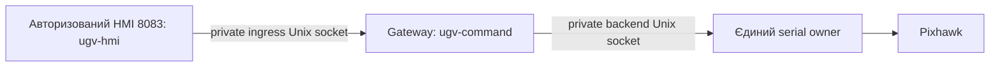

# UGV Web DISARM — штатний ArduPilot, DISARMED_OBSERVED

Гілка `feature/ugv-hmi-disarm`, база `f4462926b40dc888a77b18e6fbce105dd0a776a5`.
Це **підготовлений нерозгорнутий пакет**, не зміна працюючих служб.
Нова семантика погоджена користувачем: спостережений DISARMED не є
доказом виконання конкретного DISARM-запиту. Встановлений фізичний
E-STOP залишається незалежним і цим пакетом не керується.

## Контракт

У кожній відповіді окремо повертаються:

| Поле | Значення |
| --- | --- |
| `delivery_state` / `state` | `QUEUED` — прийнято для доставки, без write; `SENT` — повний write у поточний owner FD; `REJECTED` — відхилено до write; `UNKNOWN` — доставка невизначена |
| `observation_state` | `DISARMED_OBSERVED`, `ARMED_OBSERVED` або `UNKNOWN` |
| `command_outcome` | Завжди `UNKNOWN`: причинне виконання цього запиту не доведене |
| `observation_pending` | Чи очікується після-write спостереження в обмеженому вікні |
| `heartbeat_*` | Вік, freshness limit, source, RX counter і monotonic stamp свіжого спостереження; при UNKNOWN — null |
| `ack_diagnostic` | Необов'язкова діагностика з явним `scope=UNCORRELATED`, не результат транзакції |

DISARMED_OBSERVED потребує свіжого HEARTBEAT ArduPilot Rover від того
самого зафіксованого FC, отриманого **після завершення write**: новіші
RX counter/stamp, той самий owner epoch. ACK не потрібний. Старий,
повторний, позитивний чи негативний ACK не підтверджує й не відхиляє
цей запит: він може належати іншій команді.

При втраті зв'язку, stale, source/clock fault спостереження стає UNKNOWN.
Пізніший ARMED змінює його на ARMED_OBSERVED. SENT зберігається як факт
повного write під час роботи owner, навіть якщо спостереження прострочене.
Після restart старий owner context стає UNKNOWN; повтору запису немає.
Не використовувати ані поле доставки, ані спостереження як ARM/START/RESUME
або загальний дозвіл руху. STOP_LATCH не очищується.

## Штатна команда та ідемпотентність

Власник кодує тільки COMMAND_LONG, MAV_CMD_COMPONENT_ARM_DISARM=400,
confirmation=0, param1=0, param2=0, param3..7=0. Force-disarm не використовується.
Source фіксований 255/190; encoder/serial FD спільні з owner під його lock.
Нових serial-підключень немає.

Робочий DISARM більше не витрачає source component ID. Історична таблиця
`identities` **не видаляється, не очищується й не перевикористовується**.
Додається лише `delivery_evidence` для owner epoch/write baseline.
Перевірено понад 254 нових UUID з незмінними історичними identity rows.
Це відмова від причинного ACK-proof, а не «виправлення» його обмежень.
Старі strict-mode CONFIRMED записи віддаються як UNKNOWN, не як новий успіх.

UUID з actor_id зберігається durable до send attempt. Повтор того самого
UUID не дає другого write, у тому числі після рестарту. Частковий write,
виняток, втрачена відповідь або невизначений стан не повторюються автоматично.
Параметри ARM/force/target/fd не приймаються через HTTP/IPC.

## Окремий gateway



`disarm_control/gateway.py` не відкриває serial, GPIO, TCP або дочірні
процеси й не отримує FD через SCM_RIGHTS. Передає лише DISARM/STATUS.
Durable ідемпотентність належить owner; gateway нічого не пересилає повторно
після транспортної помилки й не вигадує SENT або здорове спостереження.

CLI вимагає три різні nonroot UID, два різні RPC GID та явний enable flag.
SocketPolicy перевіряє точні owner UID/GID, directory 0710/socket 0660,
peer UID, inode й випадковий nonce/op/request_id. У клієнта немає права
запису в directory. Private same-UID режим залишено лише для ізольованих
програмних fixtures. Фактичні service UID/групи зараз не створені.

HMI перевіряє session, явне `pixhawk.disarm`, CSRF, Origin та Sec-Fetch-Site.
Жодна DEFAULT_ROLE автоматично не має DISARM. Намір пишеться в auth audit
до dispatch, owner зберігає delivery evidence; HMI журналює переходи станів,
а не кожне опитування. Gateway пише обмежені correlation metadata у journal.
Peer UID доводить service identity, не особисту волю людини; frontend
залишається довіреною межею RBAC. Root/компрометований frontend не усуваються
самим створенням нового gateway UID.

## Legacy 8084 і HoldBench

**Лише в підготовленій копії** `owner/stop_latch_test/server.py` усі
HTTP mutation methods відхиляються `LEGACY_CONTROL_DISABLED`, навіть
зі старим/підробленим тестовим CSRF. GET /api/state лишається доступним,
контрольний токен не повертається, кнопки legacy-керування не подаються.
8082 /api/telemetry незалежний і продовжує працювати.

У production-профілі `--enable-bench-hold` відсутній. DISARM intent
скасовує незавершений HoldBench і лишає latch/STOPPED; RESET та повторне
увімкнення HOLD під час запиту заборонені. Жодних автоматичних ARM,
RESET, START, RESUME або змін режиму немає. Працюючий HoldBench/8084 у
цьому етапі НЕ змінений — закриття застосовується лише при майбутній інтеграції.

## UI

Помітна touch-кнопка залишається в секції Pixhawk, окремо від DEMO.
UI показує «прийнято», «записано в serial», «спостерігається DISARMED»
або UNKNOWN; ніколи «цей DISARM виконано/підтверджено».
STATUS опитується одним foreground timer без повторного POST. Втрата
мережі, фонова вкладка, local age expiry або re-ARM прибирають здоровий
DISARMED. Після невизначеності потрібне окреме підтвердження оператора
для нового UUID; ця кнопка змінює лише стан інтерфейсу, не робить RESET.

## Вимкнення, backup і відкат

За замовчуванням frontend і gateway не приймають нові команди.
Root-managed inhibit marker блокує gateway і owner, у тому числі queued
до write. При помилці stat/непридатному policy directory — fail closed.
Вимкнення не відкликає вже записаний packet. Видалення marker не
вмикає процес автоматично. STATUS та телеметрія залишаються для читання.

Точні налаштування й шаблони: [deploy/README.md](deploy/README.md).
Процедура backup/disable/rollback: [DEPLOYMENT.md](DEPLOYMENT.md).
Потрібні окремий дозвіл і реальні cross-UID/sandbox тести перед deployment.
Не встановлювати шаблони з нульовими UID/GID placeholders.

## Перевірка без обладнання

```sh
PYTHONDONTWRITEBYTECODE=1 /home/ugv-operator/.venv/bin/python hmi_disarm_prepared/run_checks.py
PYTHONPATH=hmi_disarm_prepared/auth:hmi_disarm_prepared PYTHONDONTWRITEBYTECODE=1 \
  /home/ugv-operator/.venv/bin/python hmi_disarm_prepared/tests/browser_check.py
```

Тести використовують disposable auth/owner DB, Unix sockets у /tmp,
підміну serial writer і hmiFetch. Реальні GPIO/Pixhawk не читаються,
команди обладнанню не надсилаються. Browser viewport — 1280×800 та
800×1280; це не фізична перевірка Sigma A1035.

Підсумок поточної перевірки — [OBSERVED_VALIDATION.md](OBSERVED_VALIDATION.md).
Доступний hardware-isolated single-UID прогін та блокер реального
cross-UID/systemd етапу — [ISOLATION_VALIDATION.md](ISOLATION_VALIDATION.md).
Повний склад підготовки — `COMMIT_FILES.txt`, SHA256 — `SOURCE_MANIFEST.json`.
Документи AUDIT.md/TECHNICAL_DECISION.md описують попередній strict ACK
аналіз; поточний контракт визначений цим README і новою реалізацією.

Не перевірені реальні UIDs/DAC/systemd sandbox, actual DISARM/latency,
firmware-specific поведінка і приводи. Фізичний E-STOP незалежний;
спостережений DISARMED не доводить фізичну нерухомість коліс. Криптографічну
автентифікацію MAVLink не додано. State/IPC/disk failure не дають hard-real-time
гарантій. Зупинка перед deployment, commit і push.
